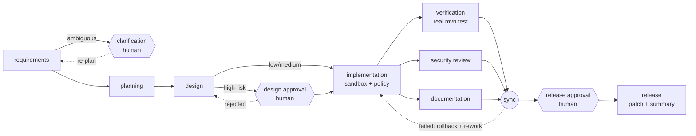

# Agentic Software Engineering System: URL Shortener

A working prototype that turns a requirement into a **reviewable, tested, documented and human-approved change**
using a governed, multi-agent SDLC built on **LangGraph**, demonstrated on a **Spring Boot URL shortener**.



| | |
|---|---|
| **Service** | `url-shortener/`: Java 21, Spring Boot 3.5, JPA, Flyway. Short links, redirects, analytics (daily series, unique visitors, referrers), idempotency keys, rate limiting, SSRF/phishing-safe URL validation, RFC 9457 errors, OpenAPI, health/metrics. |
| **Orchestrator** | `orchestrator/`: Python 3.12, LangGraph 1.x, LangChain Core, Anthropic SDK (`claude-opus-5-5`). Explicit dependency graph with entry/exit gates, parallel validation with a synchronisation barrier, human checkpoints, durable state, bounded retries, fallbacks, rollback, safe stop, policy guardrails, hash-chained audit, reliability metrics, dynamic re-planning. |
| **Evidence** | [`docs/evidence/`](docs/evidence/README.md): five reproducible runs (greenfield, brownfield, ambiguous, policy violation, resilience drill) plus one **live Claude run** where `claude-opus-5-5` generated spec, design, code and 22 tests that pass the real build (67/67). Each run has its patch, build logs, audit log, metrics and engineering summary. |

## Setup

Prerequisites: **JDK 21+**, **Maven 3.9+**, **Python 3.11+**.

```bash
make setup          # python venv + orchestrator (editable) with dev tools
make test           # Java: mvn verify (45 tests) + orchestrator: ruff + 70 tests
make demo           # all scenarios + drills against the real build; regenerates docs/evidence (~1-2 min)
make service        # run the URL shortener on http://localhost:8080 (Swagger UI: /swagger-ui.html)
```

Without `make`: `cd url-shortener && mvn verify`; `cd orchestrator && python3 -m venv .venv && .venv/bin/pip install
-e ".[dev]" && .venv/bin/pytest`.

## Using the orchestrator

```bash
cd orchestrator
# Unattended, with recorded reviewer decisions:
.venv/bin/agentic run --scenario brownfield --llm offline --approvals auto

# Human in the loop: the run pauses durably at each checkpoint
.venv/bin/agentic run --scenario ambiguous --llm offline            # -> PAUSED at clarification
.venv/bin/agentic status <run-id>
.venv/bin/agentic resume <run-id> --decision approve --approver you@team --accept-defaults
.venv/bin/agentic resume <run-id> --decision reject  --approver you@team --comment "use label-boundary matching"
.venv/bin/agentic resume <run-id> --decision approve --approver you@team --acknowledge

# Operations
.venv/bin/agentic stop <run-id>                 # safe stop at the next stage boundary
.venv/bin/agentic audit verify <run-id>         # tamper check of the hash-chained audit log
.venv/bin/agentic audit show <run-id>           # execution trace
.venv/bin/agentic metrics [--prometheus]        # success rate, retries, rollbacks, MTTR, latency
.venv/bin/agentic graph                         # the SDLC graph as mermaid

# Live LLM (Claude via the official Anthropic SDK); recorded responses remain the fallback provider
export ANTHROPIC_API_KEY=...
.venv/bin/agentic run --scenario greenfield --llm claude
.venv/bin/agentic run --requirement "Add a GET endpoint that lists the 20 most recent links" --kind greenfield --llm claude

# Fault injection (resilience)
.venv/bin/agentic run --scenario greenfield --llm offline --approvals auto \
  --fault llm_transient:planning=2 --fault llm_down:documentation=1 --fault crash:release=1
```

Each run writes `orchestrator/runs/<run-id>/` with `audit.jsonl`, `metrics.json`, `artifacts/`, `logs/`,
`snapshots/`, `workspace/` (sandbox) and `release/` (`change.patch`, `ENGINEERING_SUMMARY.md`,
`traceability.json`, `RELEASE_NOTES.md`). Nothing touches `url-shortener/` unless you pass `--promote` **and** the
release approval authorises promotion.

## Documentation

| Document | Contents |
|---|---|
| [docs/ARCHITECTURE.md](docs/ARCHITECTURE.md) | Components, orchestration model, control flow, governance envelope, key decisions |
| [docs/SCENARIOS.md](docs/SCENARIOS.md) | Greenfield, brownfield, ambiguous (+ two drills): decomposition, orchestration, validation |
| [docs/TESTING.md](docs/TESTING.md) | Testing approach, test pyramid, CI |
| [docs/RISKS_AND_TRADEOFFS.md](docs/RISKS_AND_TRADEOFFS.md) | Failure scenarios -> guardrails -> proving tests; trade-offs; assumptions; limitations |
| [docs/REQUIREMENTS_TRACEABILITY.md](docs/REQUIREMENTS_TRACEABILITY.md) | Every assignment requirement -> code -> executed evidence |
| [docs/ENGINEERING_SUMMARY.md](docs/ENGINEERING_SUMMARY.md) | Plan/rationale, artifacts, results, risks, assumptions, limitations |
| [url-shortener/README.md](url-shortener/README.md) | Service API, configuration, design notes |
