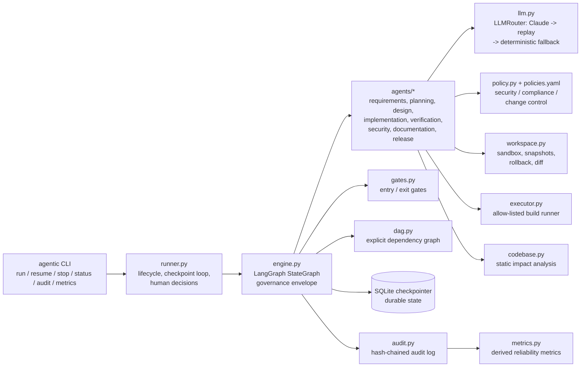
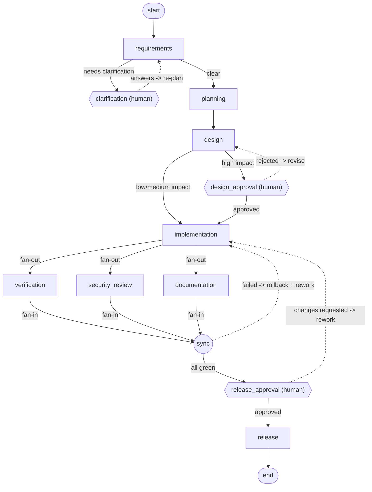

# Architecture

Two deliverables live in this repository:

| Component | Tech | Role |
|---|---|---|
| `url-shortener/` | Java 21, Spring Boot 3.5, JPA, Flyway, H2 | The production service: core link APIs, analytics, reliability controls. Also the **target system** that the agents change. |
| `orchestrator/` | Python 3.12, LangGraph 1.x, LangChain Core, Anthropic SDK | The agentic SDLC engine that turns a requirement into a reviewed, tested, documented, approved change to the service. |

## 1. Components of the orchestrator



| Module | Responsibility |
|---|---|
| `dag.py` | Single source of truth for stages, their data dependencies (`consumes`), kinds (agent / checkpoint / join), gates and control edges. Validated at start-up: acyclic, and every data dependency reachable along control flow. |
| `engine.py` | Builds the LangGraph graph, wraps every agent in the governance envelope (below), implements human checkpoints as `interrupt()`s, the parallel fan-out/fan-in, the rework loop and re-planning. |
| `gates.py` | Pure functions. Entry gates protect a stage from incomplete, stale or unapproved inputs; exit gates decide whether output may flow downstream. |
| `agents/` | One agent per stage. An agent receives **only** the artifacts its stage declares in `consumes`, the least-privilege context. |
| `llm.py` | `ClaudeChatModel` (a LangChain chat model over the official Anthropic SDK, `claude-opus-5-5`, server-side refusal fallbacks), `ReplayChatModel` (deterministic recorded responses), `LLMRouter` (bounded retries, corrective feedback on invalid output, provider fallback, budget, audit). |
| `policy.py` | Policy-as-code engine over `config/policies.yaml`: path allowlist, protected paths, immutable migrations, diff-size limits, tests-required, no test deletion, scope creep, secrets, dangerous APIs, PII logging, etc. |
| `workspace.py` | Agents never touch the real project. They work on a sandbox copy with named snapshots, all-or-nothing change application, exactly-once edit matching and unified diffs. |
| `executor.py` | Runs the real build (`mvn test`) with allow-listed binaries, a timeout, and an environment scrubbed of credentials (generated code never sees the orchestrator's API keys). Parses Surefire reports. |
| `codebase.py` | Type-level dependency graph of the Java code: layers, stereotypes, endpoints and tables. Impact = reverse-dependency closure, plus controller -> service -> repository -> table data flows. |
| `audit.py` | Append-only JSONL with SHA-256 chaining (`prev_hash`), sequence numbers, trace/span ids, secret redaction and idempotent emission (dedupe keys survive node re-execution). |
| `metrics.py` | Success rate, retry/rollback/fallback frequency, MTTR, end-to-end and active latency (human wait excluded), LLM latency. All computed *from the audit log*, with Prometheus export. |
| `safety.py` | Kill switch (`agentic stop`) and budgets (LLM calls, rework cycles, design revisions, clarification rounds, wall-clock). |

## 2. Orchestration model

The SDLC is a **stateful graph, not a chain**. Generated from `dag.py` (`agentic graph`); dotted edges are loops:



Not drawn: every node can route to `halted` (terminal; snapshots the failed workspace for forensics, restores the
baseline, records `run_halted`), and every agent stage can **pause** on a safe-stop request.

### Data dependencies vs control flow

`consumes` (data) and control edges are deliberately separate:

- **Data**: `implementation` consumes `requirements`, `planning` and `design`; `documentation` consumes
  `requirements`, `design` and `implementation`; and so on. This drives context isolation and **invalidation**.
- **Control**: loops, approvals, parallelism. `validate_control_flow()` proves that no stage can run before its
  inputs exist.

### Sequential and parallel paths with synchronisation

`requirements -> planning -> design -> implementation` is sequential. After implementation, LangGraph fans out to
three branches in the same superstep: **verification** (real build), **security_review** (policy scan of the full
diff) and **documentation**. `sync` is a barrier (`add_edge([...], "sync")`) that waits for all three, then decides
whether to release, roll back and rework, or halt. Branches share no mutable state. The documentation agent writes
to the run's artifact area, not the workspace being built and scanned; `release` merges the docs in afterwards.
Parallel writes to state use merge reducers, and `halt` uses a first-wins reducer.

## 3. The governance envelope (every agent stage)

```
safe-stop check (durable pause) -> wall-clock budget -> ENTRY GATE
  -> bounded retries (transient errors) -> agent
       -> LLMRouter: provider chain x bounded retries x schema/semantic validation with corrective feedback
       -> deterministic fallback where safe (never for code generation)
  -> EXIT GATE -> output fingerprint -> RE-PLAN (invalidate downstream if output changed)
  -> decision lineage + audit events + artifact persisted
```

| Control | Implementation |
|---|---|
| Entry/exit gates | `gates.py`; results audited as `gate_evaluated` |
| Bounded retries | LLM: `llm_max_retries` with exponential backoff and jitter. Stage: `stage_max_attempts`. Rework: `max_rework_cycles`. Design: `max_design_revisions`. Clarification: `max_clarification_rounds` |
| Fallback | (1) Claude server-side `fallbacks: "default"` on refusals, (2) provider chain Claude -> recorded replay, (3) agent-level deterministic fallback for requirements, planning, design and docs. **Implementation has no fallback**: the system never fabricates production code. |
| Rollback | Snapshot before every implementation round. Restored on blocking policy findings, failed validation (before rework), reviewer "request changes", and on halt (to baseline, keeping a forensic copy) |
| Safe stop | `agentic stop <run>` (kill switch) or fault injection; checked at every agent stage boundary, including inside parallel branches. It is an `interrupt`: state is checkpointed and an operator chooses `continue` or `abort` |
| Budgets | `BudgetGuard`. Exceeding one is a safe terminal halt (`budget_exceeded`) |
| Human checkpoints | `clarification`, `design_approval` (only when risk is high), `release_approval` (always). Implemented with `interrupt()` and `Command(resume=...)` |
| Separation of duties | `validate_decision`: approver must be a named human, not `agent`/`system`/`ai`/`agent:*` etc. Invalid decisions fail closed (halt) |
| Durable state | `SqliteSaver` checkpoints after every superstep. A crash, pause or process restart resumes from the last completed step (`agentic resume`). Completed stages are not re-executed |

### Risk classification (deterministic, LLM cannot downgrade)

| Signal | Source | Effect |
|---|---|---|
| Planned files under `domain/` or `db/migration/`, or declared schema changes | `policies.yaml: schema_paths` | high -> design approval |
| Security-sensitive component (`UrlValidator`, `ratelimit/`, `config/`, exception handler) | `security_sensitive` | high -> design approval |
| Modifies an existing controller (public API) | static check | high -> design approval |
| `pom.xml` | dependency change | high -> design approval |
| New endpoints only | `api_changes` | medium (no design gate; release gate still applies) |

## 4. Cross-stage context and decision lineage

- **Context**: artifacts are typed (`models.py`) and stored per stage in graph state and on disk
  (`runs/<id>/artifacts/*.json`). An agent sees only the artifacts its stage consumes, plus explicit feedback
  (review comments, failing tests, policy findings).
- **Lineage**: every agent and human decision is recorded with actor, rationale, input fingerprints and the decision
  it **supersedes** (e.g. design revision 2 superseding revision 1 after a rejection). It is rendered in each run's
  engineering summary.
- **Re-planning**: each stage records the fingerprint of its output. When a stage re-runs and its output differs,
  every completed transitive consumer is marked `stale` (entry gates refuse stale inputs) and a `replan` event names
  the invalidated set. Triggers: clarification answers, design rejection, failed validation, reviewer change
  requests.

## 5. Observability

- `audit.jsonl` per run: hash-chained and tamper-evident (`agentic audit verify`), with `trace_id` = run id plus
  span ids. Events: `run_started|resumed|paused|crashed|completed|halted`, `stage_started|completed|failed`,
  `gate_evaluated`, `llm_call` (provider, attempt, latency, prompt/response fingerprints), `retry`, `fallback`,
  `rollback`, `replan`, `policy_evaluated`, `approval_requested|decided`, `safe_stop_*`, `budget_exceeded`,
  `verification_result`, `promoted`.
- `metrics.json` per run and `agentic metrics [--prometheus]` across runs.
- `release/ENGINEERING_SUMMARY.md` per run: plan and rationale, architecture/impact, artifacts, traceability
  (requirement -> task -> file -> test), validation, approvals, risks, lineage, metrics, assumptions, limitations.

## 6. Key decisions

| # | Decision | Why | Rejected alternative |
|---|---|---|---|
| 1 | LangGraph `StateGraph` + SQLite checkpointer | Native interrupts, parallel supersteps, reducers and durable resume; avoids a home-grown scheduler | Hand-rolled state machine; Temporal (heavy for a prototype) |
| 2 | Explicit `dag.py` separate from graph wiring | Data dependencies drive invalidation and context isolation; control flow drives loops. Keeping them apart makes both verifiable | Inferring dependencies from edges (loops make that ambiguous) |
| 3 | Deterministic guardrails around LLM output | Ambiguity detection, impact analysis, risk classification, policy and gates are code. The model proposes, the system disposes | Trusting model self-assessment |
| 4 | Real build as the verification oracle | "Generated code passes the real test suite" is evidence; "the model says it works" is not | LLM-judged correctness |
| 5 | Sandbox + patch as the deliverable | The reviewable outcome is a diff plus evidence; promotion needs `--promote` *and* an approval that authorises it | Agents writing to the working tree |
| 6 | Replay provider for offline runs | Reproducible CI and demos without keys or network. Orchestration, governance and verification remain real | Mocking at the agent level (would hide the LLM path) |
| 7 | Metrics derived from the audit log | One source of truth; every number is explainable from recorded events | Separate counters that can drift |
| 8 | Fail closed | Invalid approvals, exhausted budgets and unrecoverable policy violations halt and roll back | Best-effort continuation |
| 9 | Parallel branches share no mutable state | Avoids races between the build and the docs/security writers | Locks |
